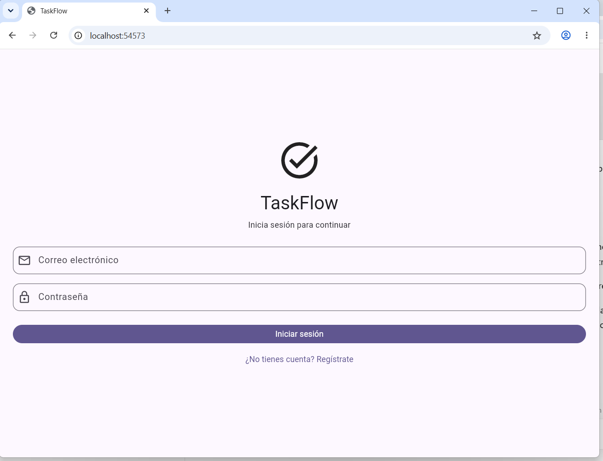
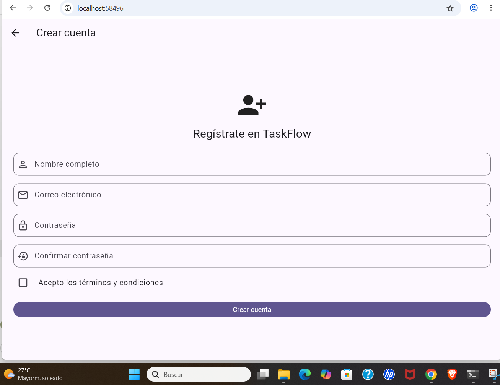
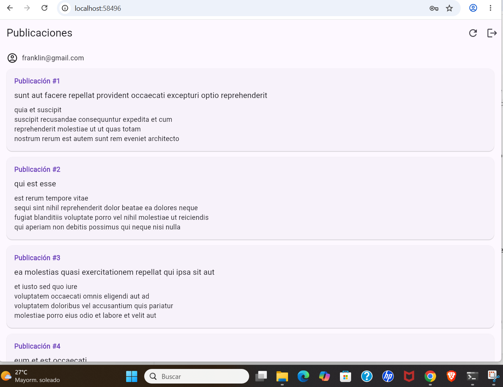
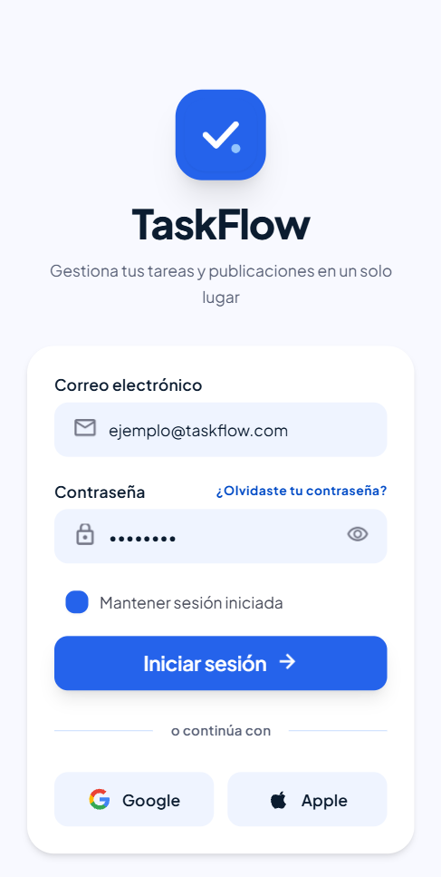
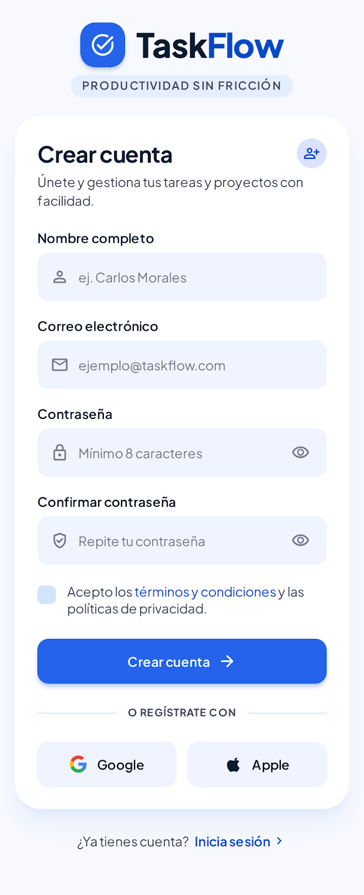
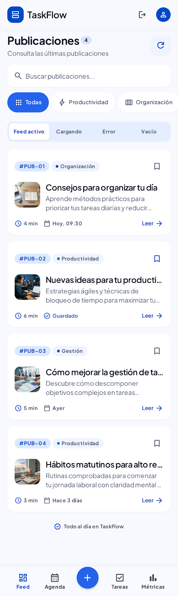

# TaskFlow — Parcial 2

Aplicación desarrollada con Flutter y Dart para la asignatura Desarrollo de Aplicaciones Móviles.

## Funcionalidades

- Inicio de sesión con validación de correo y contraseña.
- Registro con nombre, correo, contraseña, confirmación y aceptación de términos.
- Navegación entre Login, Registro y Listado.
- Consulta de publicaciones desde una API REST pública.
- Paginación automática al desplazarse por la lista.
- Estados de carga, error, reintento y lista vacía.
- Actualización manual de publicaciones.
- Cierre de sesión.

## Tecnologías utilizadas

- Flutter y Dart.
- Riverpod para el manejo del estado.
- HTTP para las solicitudes a la API.
- JSONPlaceholder como API pública de publicaciones.
- Material Design.

## Estructura principal

```text
lib/
├── datos/
│   └── publicaciones_api.dart
├── estado/
│   └── publicaciones_provider.dart
├── modelos/
│   └── publicacion.dart
├── pantallas/
│   ├── login_screen.dart
│   ├── registro_screen.dart
│   └── listado_screen.dart
└── widgets/
    └── campo_formulario.dart
```

## Cómo ejecutar el proyecto

Se necesita Flutter instalado y conexión a Internet para consultar las publicaciones.

Desde PowerShell, dentro de la carpeta del proyecto:

```powershell
flutter pub get
flutter run
```

Para analizar el código:

```powershell
flutter analyze
```

## Capturas de pantalla

A continuación se muestran las capturas de la aplicación desarrollada.

### Inicio de sesión


### Registro


### Listado de publicaciones


## Evidencias de la Semana 14

- Creación de tareas: `Evidencias_Semana14/03_Crear_Tarea.png.png`
- Pruebas de API: `Evidencias_Semana14/04_Pruebas_API.png.png`
- Pruebas generales: `Evidencias_Semana14/05_Pruebas_Generales.png.png`

## Nota sobre autenticación

El inicio de sesión y el registro utilizan validaciones en la aplicación y simulaciones de espera. No representan una autenticación conectada a un servidor ni un registro persistente de usuarios.
## Diseños de Google Stitch

- **Enlace público:** [TaskFlow — Google Stitch](https://stitch.withgoogle.com/projects/10528244070720033011).

### Diseño de Login



### Diseño de Registro



### Diseño de Listado


## Repositorio de GitHub

https://github.com/Franklin23r/TaskFlow-Parcial2


